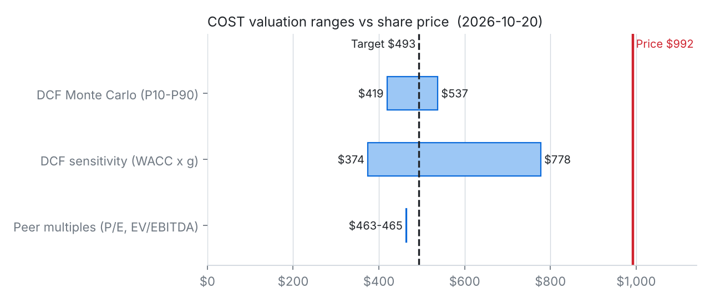
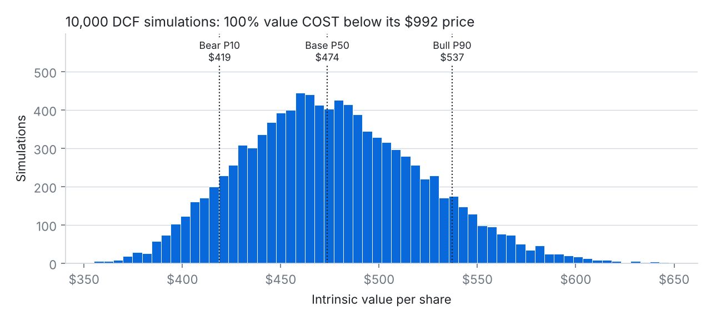
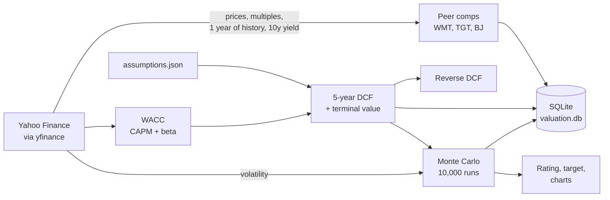

# Costco Equity Valuation Engine

[](https://colab.research.google.com/github/karthikVenkata-Create/Costco-Equity-Valuation-Engine/blob/main/Costco_Valuation_Colab.ipynb)

This started as a homework assignment. Costco was my assigned company in a finance class, and after writing a report on its capital structure I wanted to go further and actually value the stock. I built the model in Python so it pulls current market data every time it runs instead of sitting in a spreadsheet with numbers from one day.

You can run it in your browser with the Colab button above, no install needed.

Bommisetty Venkata Karthik, MBA (Finance) + MS Business Analytics, UIC

---

## My call: SELL, $493 target

When I ran the model with live data on October 20, 2026, Costco was trading at $992.35. My DCF puts it at about $493 a share. When I ran it 10,000 times with different growth, margin and discount rate assumptions, most of the values landed between $419 and $537, and none of them came close to the current price.

I want to be clear that I think Costco is a great company. It barely uses debt, members pay up front, suppliers basically fund its inventory, and it covers its interest payments about 80 times over. My issue is the price. At 48x earnings and 12x book value, investors are paying for years of perfect execution from a business that keeps only about 3 cents of every sales dollar as profit.

A few things convinced me:

1. **The growth the price assumes isn't realistic.** I ran the DCF backwards to see what growth would justify $992 a share. Keeping margins where I have them, Costco would need revenue to grow around 28% a year for five years. It grew 10.1% in FY2026, and that was still helped by the 2024 membership fee increase. My base case assumes 8% fading to 6%.
2. **The result held up when I stress-tested it.** None of the 10,000 simulations got close to the current price. The most optimistic corner of my sensitivity table (6.8% WACC, 4% long-term growth) still only gets to $778. Peer multiples point the same way: at the median P/E of Walmart, Target and BJ's, Costco would be worth about $463.
3. **A lot depends on membership fees.** Fees are under 2% of revenue but about half of operating income. If renewal rates slip from around 90%, earnings would take a much bigger hit than the revenue numbers suggest.

One thing I had to think about: this is a valuation call, not a prediction that the stock drops next month. When I simulated where the stock could trade in a year based on its normal volatility, the odds of it actually hitting $493 were under 1%. Expensive stocks can stay expensive for a long time, especially ones people trust as much as Costco. My point is that the risk/reward at this price is bad, not that a crash is coming.





---

## How it works



Each run does roughly this:

- Pulls prices and multiples for Costco, Walmart, Target and BJ's, plus a year of daily prices and the 10-year Treasury yield
- Builds a comps table and shows what Costco would be worth at its peers' P/E and EV/EBITDA
- Calculates WACC using the current Treasury yield and a beta from two years of weekly returns against the S&P 500
- Runs a 5-year DCF with a terminal value and a sensitivity table
- Runs the reverse DCF described above
- Runs two separate Monte Carlo simulations
- Saves everything to a SQLite database so I can see how the valuation changes over time

**Why two simulations?** I originally planned to use the stock's historical volatility to stress-test the DCF, but that mixes two different things. How much a stock's price moves day to day doesn't tell you how uncertain its future cash flows are. So the first simulation reruns the DCF with different business assumptions to get a range for what Costco is worth. The second uses the stock's volatility to see where the price might actually trade in a year. Comparing the two is how I got to the valuation vs timing point above.

---

## My assumptions

All the inputs are in [`assumptions.json`](assumptions.json), so anyone can change a number and rerun it.

- **Starting point:** Costco's actual FY2026 numbers from their earnings release. Revenue of $303.2B, operating income of $11.7B, $20.2B in cash, $6.2B of debt and 443.3M shares.
- **Revenue growth, 8% fading to 6%:** FY2026 was 10.1%, but part of that came from the fee increase rolling through renewals. I expect growth to slow as that wears off and the store base gets bigger.
- **Operating margin, 3.9% rising to 4.1%:** It was 3.85% in FY2026. I allowed a small increase from membership fees and scale, but Costco keeps product margins thin on purpose, so I didn't want to assume much.
- **Sales-to-capital, 8x:** This controls how much Costco has to reinvest to grow. Right now its revenue is about 14x its invested capital, partly because suppliers fund so much of its inventory. I used 8x to be conservative about new warehouse costs. At 14x the value only goes up to about $527, so this doesn't change the conclusion.
- **Tax rate, 24%:** Close to Costco's recent effective rate.
- **Discount rate:** Live Treasury yield, a 5% equity risk premium, and a beta from two years of weekly returns, adjusted toward 1 like most data providers do. My first version used one year of daily returns and got a beta of -0.17, which would mean Costco moves opposite to the market. That's not realistic, so the model now checks for it and falls back to Yahoo's published beta if the number looks off.
- **Long-term growth, 3%:** Roughly in line with long-run nominal GDP.
- **Rating rule:** BUY above +10% upside, SELL below -10%, HOLD in between.

## What could prove me wrong

- **Margins could grow a lot more than I expect.** If membership income, advertising and e-commerce push operating margins toward 5 or 6%, the value goes up a lot.
- **The market might just keep paying up for quality.** Costco has looked expensive on a DCF for years and still beaten the market. If investors accept a lower return for a business this stable, my discount rate is too high.
- **International growth could beat my numbers.** New warehouses in Asia and Europe could keep growth near 10% for longer than I'm assuming.

## What I learned

The biggest thing was learning to separate a great company from a good stock. Everything about Costco's balance sheet looks strong, but that doesn't make it a good buy at any price. I also learned how much a DCF depends on the terminal value. About 84% of my value comes from years after 2031, which made me a lot more careful about what I assume there.

On the technical side, I liked having live data, the DCF, the simulations and a SQL log all in one script instead of spread across Excel tabs. It also made it easy to rerun everything when an assumption changed.

---

## Running it

The easiest way is the Colab button at the top. To run it locally:

```bash
pip install -r requirements.txt && python valuation_engine.py --charts
```

`--offline` runs it without internet using the FY2026 numbers (peer comps get skipped), and `--runs 50000` changes the number of simulations.

To see past runs:

```sql
SELECT run_timestamp_utc, price, wacc, dcf_value, target_price, rating
FROM runs ORDER BY run_id DESC;
```

## Files

```
├── valuation_engine.py          the model
├── assumptions.json             all the inputs
├── Costco_Valuation_Colab.ipynb run it in your browser
├── charts/                      charts used in this README
├── requirements.txt
└── README.md
```

## Sources

- Costco FY2026 earnings release (Sept 24, 2026), investor.costco.com
- Yahoo Finance through the `yfinance` library

*This is a student project, not investment advice. yfinance is an unofficial data source, so numbers can occasionally be delayed or missing. The figures above come from my October 20, 2026 live run, and running the model again will update them.*
