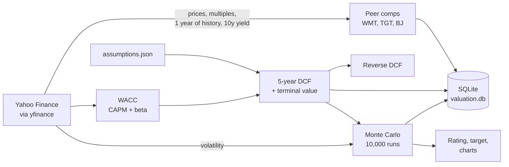

# Costco Equity Valuation Engine

[](https://colab.research.google.com/github/karthikVenkata-Create/Costco-Equity-Valuation-Engine/blob/main/Costco_Valuation_Colab.ipynb)

This started as a homework assignment. Costco was my assigned company in a finance class, and after writing a report on its capital structure I wanted to go further and actually value the stock. I built the model in Python so it pulls current market data every time it runs instead of sitting in a spreadsheet with numbers from one day.

**[Try the model on my website](https://karthikvenkata-create.github.io/costco.html)**: change the growth, margins or discount rate and watch the value, reverse DCF and simulations update. You can also run the full Python version in your browser with the Colab button above, no install needed.

Bommisetty Venkata Karthik, MBA (Finance) + MS Business Analytics, UIC

> **In short**
> - **SELL, $493 target**, with Costco at $992 on October 20, 2026.
> - The price only works if Costco keeps growing about 10% a year for another 20-plus years. I think growth cools sooner.
> - Even if everything goes right, a buyer at $992 earns about 6.6% a year, only 1.4 points more than a 10-year Treasury bond.

---

## My call: SELL, $493 target

When I ran the model with live data on October 20, 2026, Costco was trading at $992.35. My DCF puts it at about $493 a share. When I ran it 10,000 times with different growth, margin and discount rate assumptions, most of the values landed between $420 and $652. All 10,000 came in below the current price, and only about 1% got above $800.

I want to be clear that I think Costco is a great company. It barely uses debt, members pay up front, suppliers basically fund its inventory, and it covers its interest payments about 80 times over. My issue is the price. At 48x earnings and 12x book value, investors are paying for years of perfect execution from a business that keeps only about 3 cents of every sales dollar as profit.

A few things convinced me:

1. **The price needs Costco to beat its own best run.** I ran the DCF backwards to see what it takes to justify $992 a share. My first version only let the next five years change, which said Costco needs about 28% growth a year. That overstates it, because most of a company like this is worth what happens after year five. So I solved it three other ways. The price works if Costco grows revenue 10% a year for about 21 years before slowing down, or grows 5.9% a year forever after 2031, or roughly doubles its operating margin to about 7.9%. For context, Costco's revenue has compounded about 8.7% a year since FY2004. So the market isn't asking for something impossible. It's asking for Costco to do a little better than the last two decades, for about as long again, starting from a $300 billion base. My base case assumes it slows to 8% fading to 6% over five years, then 3%. That slowdown is the core of my call.
2. **The result held up when I stress-tested it.** My first set of simulation ranges was too narrow, so I widened them (how I set them is under My assumptions). Even with growth anywhere from 3% to 11% a year, margins up to 5.1% and a discount rate swinging 1.5 points either way, every simulation still landed below the current price. The most optimistic corner of my sensitivity table (6.8% WACC, 4% long-term growth) gets to $778. Peer multiples point the same way: at the median P/E of Walmart, Target and BJ's, Costco would be worth about $463.
3. **A lot depends on membership fees.** Fees are under 2% of revenue but about half of operating income. If renewal rates slip from around 90%, earnings would take a much bigger hit than the revenue numbers suggest.

**Most analysts disagree with me.** As of October 21, 2026, 20 of the 27 analysts covering Costco rate it a Buy, with an average target around $1,094, and even the lowest target ($781) is well above mine ([TipRanks](https://www.tipranks.com/stocks/COST/forecast)). I think the gap comes down to the runway question above. The Street is paying for Costco to keep compounding near its historical pace for a long time, and I'm assuming that growth fades much sooner. I could be wrong on that, but it's a deliberate bet, not a modeling accident.

**Why I think growth slows.** Costco's roughly 10% growth comes from two places. About 3 points come from new warehouses: it opened 25 net new ones in FY2026 on a base of about 914, and plans about 28 more in FY2027. The rest comes from existing warehouses, where comparable sales grew 6.6% excluding gas and currency. The new-warehouse part can't really speed up. Costco opens about 25 to 30 a year, and as the base grows, the same number of openings adds a smaller percentage. With 647 of its 939 warehouses already in the U.S. and Puerto Rico, more of the new growth has to come from international markets, which take years to ramp up. So the price is really a bet that existing-warehouse sales keep growing 6 to 7% a year for two decades. Same-store growth for mature retailers usually drifts down toward inflation plus a little extra traffic, and that's the fade my base case assumes: 8% fading to 6% over five years, then 3%.

**Even if everything goes right, the return is thin.** A lot of people own Costco for safety and consistency, not because they ran a DCF, and that's a real preference. Investors will accept a lower return for a stock that barely moves in a recession. So I asked what return a buyer actually gets at $992, and I started from the most generous forecast I could defend instead of my own. I stacked every bull lever at once: a 10-year forecast with growth fading from 9% to 8%, margins rising to 4.8% from ads, e-commerce, Kirkland and future fee increases, and a discount rate a full point lower (6.8%) for Costco's safety and low beta. That gets the value to about $914, still about 8% below the price. Solving for the return a buyer earns at $992 in that case gives about 6.6% a year, only 1.4 points more than the 10-year Treasury, which was paying about 5.1% that day. Investors usually want several points more than that for owning a stock. Under my own base case it's worse: about 5.4%, just 0.3 points over Treasuries. I lead with the bull-case number because it already gives Costco the benefit of the doubt, so nobody can say it's low just because my forecast is pessimistic.

Nobody buying Costco is being dumb, but the price of that safety has gotten very high. Today's price already pays for the best case. If things go right, you roughly break even on valuation. If they don't, my base case says the stock is worth about half. That lopsided risk is why I'm sticking with SELL and not HOLD, even though the bull case gets close.

**This has happened before.** In 1999 Walmart was a great business trading at about 39 times earnings. Over the next decade its earnings per share grew about 10% a year, but the P/E fell to around 16, and someone who bought in 1999 was still underwater in 2008 ([The Rational Walk](https://rationalwalk.com/wal-marts-ten-year-record-a-case-study-of-the-dangers-of-overpaying-for-growth/)). Costco doesn't have to crash for SELL to be right. The business can keep doing well while the stock goes nowhere because it started too expensive.

One thing I had to think about: this is a valuation call, not a prediction that the stock drops next month. When I simulated where the stock could trade in a year based on its normal volatility, the odds of it actually hitting $493 were under 1%. Expensive stocks can stay expensive for a long time, especially ones people trust as much as Costco. My point is that the risk/reward at this price is bad, not that a crash is coming.


---

## How it works



Each run does roughly this:

- Pulls prices and multiples for Costco, Walmart, Target and BJ's, plus a year of daily prices and the 10-year Treasury yield
- Builds a comps table and shows what Costco would be worth at its peers' P/E and EV/EBITDA
- Calculates WACC using the current Treasury yield and a beta from two years of weekly returns against the S&P 500
- Runs a 5-year DCF with a terminal value and a sensitivity table
- Runs the reverse DCF described above
- Runs two separate Monte Carlo simulations
- Saves everything to a SQLite database so I can see how the valuation changes over time

**How the reverse DCF works:** It solves for the one input that makes the DCF equal today's price, five different ways: five years of growth with nothing else changed, growth forever after 2031, years of 10% growth before slowing, the 2031 operating margin, and the discount rate (which is the return a buyer earns at today's price). The first version alone exaggerates what the price needs, so I report all five. The model also runs the stacked bull case described above and compares its return with the live 10-year Treasury yield.

**Why two simulations?** I originally planned to use the stock's historical volatility to stress-test the DCF, but that mixes two different things. How much a stock's price moves day to day doesn't tell you how uncertain its future cash flows are. So the first simulation reruns the DCF with different business assumptions to get a range for what Costco is worth. The second uses the stock's volatility to see where the price might actually trade in a year. Comparing the two is how I got to the valuation vs timing point above.

---

## My assumptions

All the inputs are in [`assumptions.json`](assumptions.json), so anyone can change a number and rerun it.

- **Starting point:** Costco's actual FY2026 numbers from their earnings release. Revenue of $303.2B, operating income of $11.7B, $20.2B in cash, $6.2B of debt and 443.3M shares.
- **Revenue growth, 8% fading to 6%:** FY2026 was 10.1%, about 3 points from new warehouses and the rest from existing ones. I expect existing-warehouse growth to cool toward inflation plus a little traffic, while new openings stay around 3% of the base (see "Why I think growth slows" above).
- **Operating margin, 3.9% rising to 4.1%:** It was 3.85% in FY2026. I allowed a small increase from membership fees and scale, but Costco keeps product margins thin on purpose, so I didn't want to assume much.
- **Sales-to-capital, 8x:** This controls how much Costco has to reinvest to grow. Right now its revenue is about 14x its invested capital, partly because suppliers fund so much of its inventory. I used 8x to be conservative about new warehouse costs. At 14x the value only goes up to about $527, so this doesn't change the conclusion.
- **Tax rate, 24%:** Close to Costco's recent effective rate.
- **Discount rate:** Live Treasury yield, a 5% equity risk premium, and a beta from two years of weekly returns, adjusted toward 1 like most data providers do. My first version used one year of daily returns and got a beta of -0.17, which would mean Costco moves opposite to the market. That's not realistic, so the model now checks for it and falls back to Yahoo's published beta if the number looks off.
- **Long-term growth, 3%:** Roughly in line with long-run nominal GDP.
- **Monte Carlo ranges:** Each input gets its own bear, base and bull value, and each run draws from all four independently. Growth runs 4 points below to 4 points above the base path, so 3% to 11% a year on average, and the top end is FY2026's pace held for five years. Margin goes from 0.5 points lower to 1 point higher, which covers the margins-reach-5% scenario below. The discount rate moves 1.5 points either way, and long-term growth ranges from 2% to 4%. I skewed margins upward on purpose, which is why the simulation median ($517) is above my base case. Because the draws are independent, it's rare for every input to hit its best case in the same run. That's why the simulation doesn't reach the best corner of the sensitivity table.
- **Stacked bull case:** A 10-year forecast with growth fading from 9% to 8%, operating margin rising from 3.9% to 4.8%, and a discount rate 1 point below the live WACC. It's in `assumptions.json` under `bull_case` so anyone can change it.
- **Rating rule:** BUY above +10% upside, SELL below -10%, HOLD in between. The rating comes from the base case, not the bull case.

## What could prove me wrong

- **Margins could grow a lot more than I expect.** If membership income, advertising and e-commerce push operating margins toward 5 or 6%, the value goes up a lot.
- **The market might just keep paying up for quality.** Costco has looked expensive on a DCF for years and still beaten the market. But for most of the 2010s the 10-year Treasury paid around 2 to 3%, and in 2020-21 it was under 2% ([multpl](https://www.multpl.com/10-year-treasury-rate/table/by-year)). Back then, even a 5 or 6% expected return on Costco was a big premium over bonds. With Treasuries around 5.1% now, that premium is mostly gone, so the conditions that made "expensive" Costco work in the past aren't here anymore. The real risk to my call is rates falling back to those levels.
- **Costco's runway could be longer than I think.** This is the big one. The price works if Costco keeps growing about 10% a year for around 21 more years. It has done close to that for the last two decades, and new warehouses in Asia and Europe could keep it going.

## What I learned

The biggest thing was learning to separate a great company from a good stock. Everything about Costco's balance sheet looks strong, but that doesn't make it a good buy at any price. I also learned how much a DCF depends on the terminal value. About 84% of my value comes from years after 2031, which made me a lot more careful about what I assume there. The same thing tripped up my first reverse DCF: it said the price needed 28% growth, but only because I forced all the extra growth into five years. Asking the question a few different ways gave a much fairer answer.

On the technical side, I liked having live data, the DCF, the simulations and a SQL log all in one script instead of spread across Excel tabs. It also made it easy to rerun everything when an assumption changed.

---

## Running it

The easiest way is the Colab button at the top. To run it locally:

```bash
pip install -r requirements.txt && python valuation_engine.py --charts
```

`--offline` runs it without internet using the FY2026 numbers (peer comps get skipped), and `--runs 50000` changes the number of simulations.

To see past runs:

```sql
SELECT run_timestamp_utc, price, wacc, dcf_value, target_price, rating
FROM runs ORDER BY run_id DESC;
```

## Files

```
├── valuation_engine.py          the model
├── assumptions.json             all the inputs, including the bull case
├── Costco_Valuation_Colab.ipynb run it in your browser
├── charts/                      charts used in this README
├── requirements.txt
└── README.md
```

## Sources

- Costco FY2026 earnings release (Sept 24, 2026), investor.costco.com
- Costco FY2004 results (total revenue $48.1B), [SEC filing](https://www.sec.gov/Archives/edgar/data/0000909832/000119312504167911/dex991.htm), used for the long-run growth rate
- Analyst ratings and targets from [TipRanks](https://www.tipranks.com/stocks/COST/forecast), October 21, 2026
- Costco FY2026 comparable sales and warehouse counts from the [FY2026 results (SEC filing)](https://www.sec.gov/Archives/edgar/data/0000909832/000090983226000084/costex9918-k92426.htm), and FY2026 openings and FY2027 plans from [MarketBeat](https://www.marketbeat.com/articles/costco-ends-its-fiscal-year-on-a-high-note-eyes-big-expansion/)
- 10-year Treasury yields by year from [multpl](https://www.multpl.com/10-year-treasury-rate/table/by-year)
- Walmart's 1999-2008 record from [The Rational Walk](https://rationalwalk.com/wal-marts-ten-year-record-a-case-study-of-the-dangers-of-overpaying-for-growth/)
- Yahoo Finance through the `yfinance` library

*This is a student project, not investment advice. yfinance is an unofficial data source, so numbers can occasionally be delayed or missing. The figures above come from my October 20, 2026 live run, and running the model again will update them.*
